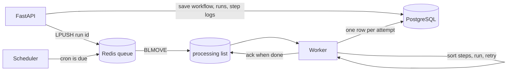

# FlowPilot

**A workflow automation engine, like a small n8n or Zapier, built from scratch in Python.**

You connect steps (a trigger, then an AI step, then an action), and FlowPilot works out the right order, runs them in the background, retries what fails, and logs every attempt.

Example workflow: *every morning, read my unread emails → AI picks the urgent ones → send me a summary.*


## Status

| Part | State |
|---|---|
| Workflow API (create, read, update, delete) | ✅ Done |
| Running order (topological sort, cycle detection) | ✅ Done |
| Passing data between steps (`{{n1.output.x}}` templates) | ✅ Done |
| Redis job queue + background worker | ✅ Done |
| Executor with retries, backoff and per-attempt logs | ✅ Done |
| LLM step (timeout, structured JSON output, repair retry) | ✅ Done |
| HTTP action (retries 5xx, never retries 4xx) | ✅ Done |
| Email action (never retried, so no duplicate emails) | ✅ Done |
| Scheduled triggers (cron, never fires the same minute twice) | ✅ Done |
| Crash recovery (processing list, reaper, resume from the last finished step) | ✅ Done |
| Visual canvas (Next.js + React Flow) | ⏳ Planned |

**58 tests pass in GitHub Actions CI**, with lint and format checks on every push.

## How it works



1. **Start a run:** the API (or the scheduler, when a cron is due) checks that the workflow has no loops, saves a run as `queued`, puts its id on a Redis queue and replies straight away (HTTP 202).
2. **The worker** moves the next run id from the queue to a processing list, runs the steps in order, and removes the id (an "ack") when the run is finished.
3. **Each step:** fill in its templates from earlier steps' outputs, run it, and save the result. If it fails, wait (1s, then 2s) and try again, up to 3 attempts.
4. **The run ends** as `succeeded`, or as `failed` with the step that broke and why.

## Design decisions

**Why a queue and a separate worker?**
A run can take minutes (LLM calls, retries with waits). The API only queues the run id, so it replies in milliseconds. To handle more runs, start more workers: they all share one queue.

**Why put only the run id on the queue, not the whole workflow?**
The database is the single source of truth. The worker always loads the latest saved version, and the queue messages stay tiny.

**Running order: Kahn's algorithm, O(V + E)**
Count how many arrows point into each step. Steps with zero are ready, so run one, then remove its outgoing arrows; any step that drops to zero becomes ready. Every step and every arrow is handled once, which makes it O(V + E).
If the sort finishes with fewer steps than the workflow has, there's a loop (for example, B waits for D and D waits for B). The API rejects it with **HTTP 422** before anything is queued.

**Retries: what gets retried, and what doesn't**
- Failed attempts wait 1s, then 2s (exponential backoff), with no wait after the last attempt.
- Steps with side effects (such as sending an email) are marked **non-retryable** and run once, so a retry can never send the same email twice.
- Success handling is in a separate `else` block, so an error while *saving* a result is never mistaken for the step failing.
- The wait function is passed in as a parameter, so tests check the exact waits (`[1, 2]`) without actually sleeping.

**LLM step: guardrails, because models don't always follow instructions**
- **Structured output:** if the step has an `output_schema`, the prompt asks for JSON in that exact shape, and the reply is checked with `json.loads` (Markdown code fences around the JSON are stripped first).
- **One repair retry:** if the reply isn't valid JSON, the step asks once more with "Reply with only JSON." If that fails too, it raises an error instead of looping, so a bad model can't burn tokens forever.
- **Timeout:** every call is wrapped in `asyncio.wait_for` (30s by default). A slow model raises a `TimeoutError`, and the executor retries the step with backoff like any other failure.
- **Cost tracking:** tokens and cost are added up across both calls, so the repair retry is never hidden.
- **Testable without an API key:** the model is plugged in with `set_llm_client()`, so the LLM tests use a fake model that is free, instant and always gives the same answer.

**HTTP step: which errors are worth retrying?**
- **5xx** (500, 503) means the server is broken or busy, so trying again later can work. The step raises a normal error and the executor retries it with backoff.
- **4xx** (400, 404) means the request itself is wrong. Sending the same request again will fail the same way, so the step raises a `NonRetryableError` and the executor stops at once, with no waiting.
- Every request has a 10s timeout. Tests use `httpx.MockTransport` as a fake server, so no real URL is ever called. One test runs the whole executor and checks a 404 is sent exactly once.

**Email step: why it is never retried (idempotency)**
If the email server sends the message but the connection drops before we hear back, the step looks like it failed. Retrying would send the same email twice, which is worse than failing once. So the email step is marked non-retryable and runs exactly once; if it fails, the run fails and the log shows why. The address is checked before anything is sent, and the sender is plugged in with `set_email_sender()`, so tests use a fake that records emails instead of sending them.

**Scheduler: what stops it from starting the same workflow twice in one minute?**
A small separate process wakes up once a minute, finds workflows whose `trigger.schedule` cron (for example `0 8 * * *`, every day at 08:00 UTC) matches the current minute, and starts them exactly like the "start run" API does, so the same worker executes them.
- Before starting a workflow it claims a Redis key for that workflow and minute with `SET ... NX EX 120`. `NX` means "only if it doesn't exist yet", and Redis does this atomically, so even two schedulers running at once can't both win. Waking up twice in the same minute starts the run only once.
- A workflow with a broken cron is logged and skipped, so one bad schedule can't stop the others.
- The current time is passed in as a parameter, so tests can say "it's 08:00" without waiting for a real clock.

**Crash recovery: what if a worker dies in the middle of a run?**
- The worker takes a run id with `BLMOVE`, which moves it from the queue to a `processing` list in one atomic step, instead of deleting it. When the run finishes (succeeded or failed), the worker removes it in a `finally` block (the "ack").
- If the worker dies, the ack never happens, so the id stays on the processing list. That missing ack is the signal.
- Once a minute, a reaper checks that list: a run that is already finished is just cleaned up (never run again); a run that has been `running` for less than 15 minutes is left alone; a run older than that is reset to `queued` and put back on the queue for another worker.
- **A rescued run resumes where it stopped.** Before running, the executor loads the steps of this run that already succeeded, reuses their saved outputs and skips them. So if a worker died right after an email step, the new worker does not send that email again. This works because every step's output is already saved to the database.

## Run it

```bash
cd backend
python -m venv .venv && source .venv/bin/activate
pip install -r requirements-dev.txt
python -m pytest -q        # 58 passed (uses SQLite + a fake Redis, so no services needed)

# full stack with Docker
cd ..
docker compose up --build  # API docs at http://localhost:8000/docs

# scheduler (starts workflows that have a cron trigger, and rescues stuck runs)
cd backend && python -m app.engine.scheduler
```

## Tech

Python 3.12 · FastAPI · async SQLAlchemy · PostgreSQL · Alembic · Redis · httpx · croniter · Docker Compose · pytest · ruff · GitHub Actions
