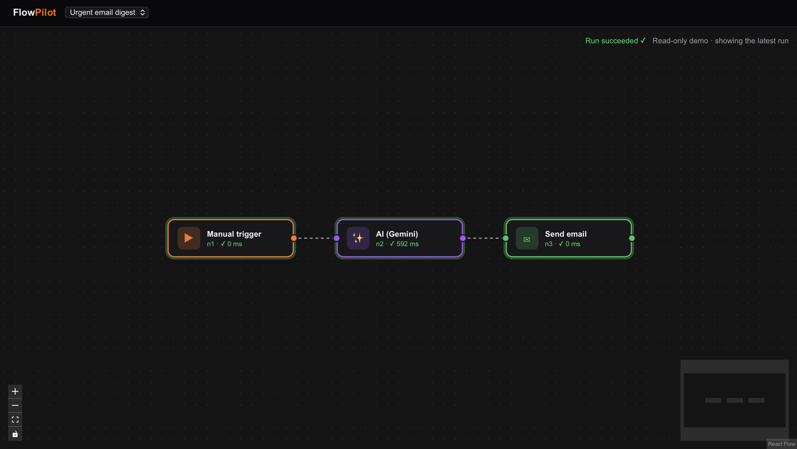
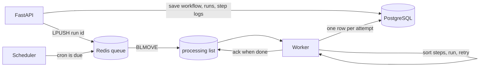
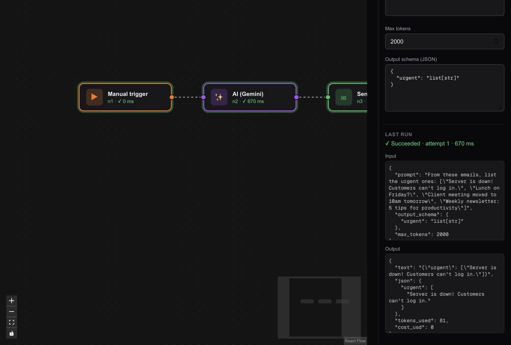

# FlowPilot

**A workflow automation engine, like a small n8n or Zapier, built from scratch in Python.**

You connect steps (a trigger, then an AI step, then an action), and FlowPilot works out the right order, runs them in the background, retries what fails, and logs every attempt.

Example workflow: *every morning, read my unread emails → AI picks the urgent ones → send me a summary.*


## Live demo

**Visual editor: https://flowpilot-gaze31.vercel.app** (read-only public demo, showing the latest real run)



The backend runs on an AWS EC2 server (Docker Compose, all five services):

- **API docs:** http://107.23.248.219:8000/docs
- **A real run, step by step** (input, output, time and tokens of each step): http://107.23.248.219:8000/runs/02762938-3794-4b0b-978a-d564aab4a298

Reading is public. Creating, changing and running workflows need an API key, so the public demo can look but not change anything.

## Status

| Part | State |
|---|---|
| Workflow API (create, read, update, delete) | ✅ Done |
| Running order (topological sort, cycle detection) | ✅ Done |
| Passing data between steps (`{{n1.output.x}}` templates) | ✅ Done |
| Redis job queue + background worker | ✅ Done |
| Executor with retries, backoff and per-attempt logs | ✅ Done |
| LLM step (timeout, structured JSON output, repair retry) | ✅ Done |
| HTTP action (retries 5xx, never retries 4xx) | ✅ Done |
| Email action (never retried, so no duplicate emails) | ✅ Done |
| Scheduled triggers (cron, never fires the same minute twice) | ✅ Done |
| Crash recovery (processing list, reaper, resume from the last finished step) | ✅ Done |
| Real providers: Google Gemini for the LLM step, a log-only email sender by default, real email through Resend when `RESEND_API_KEY` is set | ✅ Done |
| Full stack in Docker (API, worker, scheduler, Postgres, Redis) | ✅ Done |
| Deployed on AWS EC2, with an API key on every write endpoint | ✅ Done |
| Visual editor: drag, connect, configure, save, run (Next.js + React Flow) | ✅ Done |
| Live run view and step inspector (input, output, attempt, time) | ✅ Done |
| Frontend deployed on Vercel as a read-only demo | ✅ Done |
| Evals for the LLM step (precision, recall, F1, holdout set) | ✅ Done |

**103 tests pass in GitHub Actions CI**, with lint and format checks on every push.

## How it works



1. **Start a run:** the API (or the scheduler, when a cron is due) checks that the workflow has no loops, saves a run as `queued`, puts its id on a Redis queue and replies straight away (HTTP 202).
2. **The worker** moves the next run id from the queue to a processing list, runs the steps in order, and removes the id (an "ack") when the run is finished.
3. **Each step:** fill in its templates from earlier steps' outputs, run it, and save the result. If it fails, wait (1s, then 2s) and try again, up to 3 attempts.
4. **The run ends** as `succeeded`, or as `failed` with the step that broke and why.

## Design decisions

**Why a queue and a separate worker?**
A run can take minutes (LLM calls, retries with waits). The API only queues the run id, so it replies in milliseconds. To handle more runs, start more workers: they all share one queue.

**Why put only the run id on the queue, not the whole workflow?**
The database is the single source of truth. The worker always loads the latest saved version, and the queue messages stay tiny.

**Running order: Kahn's algorithm, O(V + E)**
Count how many arrows point into each step. Steps with zero are ready, so run one, then remove its outgoing arrows; any step that drops to zero becomes ready. Every step and every arrow is handled once, which makes it O(V + E).
If the sort finishes with fewer steps than the workflow has, there's a loop (for example, B waits for D and D waits for B). The API rejects it with **HTTP 422** before anything is queued.

**Retries: what gets retried, and what doesn't**
- Failed attempts wait 1s, then 2s (exponential backoff), with no wait after the last attempt.
- Steps with side effects (such as sending an email) are marked **non-retryable** and run once, so a retry can never send the same email twice.
- Success handling is in a separate `else` block, so an error while *saving* a result is never mistaken for the step failing.
- The wait function is passed in as a parameter, so tests check the exact waits (`[1, 2]`) without actually sleeping.

**LLM step: guardrails, because models don't always follow instructions**
- **Structured output:** if the step has an `output_schema`, the prompt asks for JSON in that exact shape, and the reply is checked with `json.loads` (Markdown code fences around the JSON are stripped first).
- **One repair retry:** if the reply isn't valid JSON, the step asks once more with "Reply with only JSON." If that fails too, it raises an error instead of looping, so a bad model can't burn tokens forever.
- **Timeout:** every call is wrapped in `asyncio.wait_for` (30s by default). A slow model raises a `TimeoutError`, and the executor retries the step with backoff like any other failure.
- **Cost tracking:** tokens and cost are added up across both calls, so the repair retry is never hidden.
- **Testable without an API key:** the model is plugged in with `set_llm_client()`, so the LLM tests use a fake model that is free, instant and always gives the same answer.

**HTTP step: which errors are worth retrying?**
- **5xx** (500, 503) means the server is broken or busy, so trying again later can work. The step raises a normal error and the executor retries it with backoff.
- **4xx** (400, 404) means the request itself is wrong. Sending the same request again will fail the same way, so the step raises a `NonRetryableError` and the executor stops at once, with no waiting.
- Every request has a 10s timeout. Tests use `httpx.MockTransport` as a fake server, so no real URL is ever called. One test runs the whole executor and checks a 404 is sent exactly once.

**Email step: why it is never retried (idempotency)**
If the email server sends the message but the connection drops before we hear back, the step looks like it failed. Retrying would send the same email twice, which is worse than failing once. So the email step is marked non-retryable and runs exactly once; if it fails, the run fails and the log shows why. The address is checked before anything is sent, and the sender is plugged in with `set_email_sender()`, so tests use a fake that records emails instead of sending them.

By default the sender only writes the email to the log, which is safe for demos. Set `RESEND_API_KEY` (and optionally `EMAIL_FROM`, default `FlowPilot <onboarding@resend.dev>`) in `backend/.env` and the worker sends real emails through Resend instead. A Resend 4xx (bad address, bad key) fails the step right away; a 5xx or timeout is a normal error. The key is never logged.

**Scheduler: what stops it from starting the same workflow twice in one minute?**
A small separate process wakes up once a minute, finds workflows whose `trigger.schedule` cron (for example `0 8 * * *`, every day at 08:00 UTC) matches the current minute, and starts them exactly like the "start run" API does, so the same worker executes them.
- Before starting a workflow it claims a Redis key for that workflow and minute with `SET ... NX EX 120`. `NX` means "only if it doesn't exist yet", and Redis does this atomically, so even two schedulers running at once can't both win. Waking up twice in the same minute starts the run only once.
- A workflow with a broken cron is logged and skipped, so one bad schedule can't stop the others.
- The current time is passed in as a parameter, so tests can say "it's 08:00" without waiting for a real clock.

**Crash recovery: what if a worker dies in the middle of a run?**
- The worker takes a run id with `BLMOVE`, which moves it from the queue to a `processing` list in one atomic step, instead of deleting it. When the run finishes (succeeded or failed), the worker removes it in a `finally` block (the "ack").
- If the worker dies, the ack never happens, so the id stays on the processing list. That missing ack is the signal.
- Once a minute, a reaper checks that list: a run that is already finished is just cleaned up (never run again); a run that has been `running` for less than 15 minutes is left alone; a run older than that is reset to `queued` and put back on the queue for another worker.
- **A rescued run resumes where it stopped.** Before running, the executor loads the steps of this run that already succeeded, reuses their saved outputs and skips them. So if a worker died right after an email step, the new worker does not send that email again. This works because every step's output is already saved to the database.

**Real providers, plugged in once at startup**
The LLM and email steps never call an outside service directly. Each one calls a function that is plugged in when the worker starts (`plug_in_providers()`): Google Gemini for the LLM step, and a sender that writes the email to the log for the email step. Tests plug in fakes the same way, so CI never needs an API key and never costs money. Gemini errors follow the same rule as the HTTP step: 5xx is retried, 4xx (a bad key or model name) is not.

**Going live: what is public, and what is locked**
- Reading workflows and runs is public, so anyone can look around. Creating, changing, deleting and running a workflow need an `X-API-Key` header, because a run spends the Gemini quota and the HTTP step can call any address. The key is compared with `secrets.compare_digest`, so the check takes the same time whether the first character or the last one is wrong.
- On the server, only two ports are open: 8000 for the API, and SSH for my own IP address only. Postgres and Redis are bound to `127.0.0.1`, so they are unreachable from the internet even if a firewall rule were opened by mistake.
- Secrets live in `backend/.env` on each machine and never in git or in a Docker image (`.gitignore` and `.dockerignore` both exclude it). Every service restarts on its own if it crashes or the server reboots.

## The visual editor



Drag steps from the side panel, connect them, click a step to edit its settings, save, and press ▶ Run. Each step turns green or red as the run moves along, and clicking a step shows its last input, output, attempt number and time.

**The API key never reaches the browser**
- Every call from the page goes to the editor's own server routes (`/api/...`). Those routes call the FlowPilot API, and only the write routes add the `X-API-Key` header, read from a server-only variable.
- Because the browser only ever talks to its own site, an https page never calls the plain-http API directly, so there is no mixed-content blocking.

**Public demo: read-only, enforced on the server**
- The public site has no API key at all, so its save and run routes refuse every request, even one sent with curl. Hiding the buttons is only for a clean look; the missing key is the real lock (defense in depth).
- Why read-only: an open editor would let anyone delete the demo, spend the Gemini quota, or make the HTTP step call any address from my server. The next step would be login plus per-user rate limits.

**Small decisions that prevent real bugs**
- **Save guard:** the required settings of each step type come from the backend code (`config["url"]` crashes when missing, `config.get(...)` has a default). Save refuses steps with missing settings, so a broken step never reaches the database.
- **New step ids:** the highest existing number + 1, not the count of steps. After deleting `n2` from three steps, "count + 1" would create a second `n3`.
- **Polling:** `setTimeout` after each answer instead of `setInterval`, so a slow API can't pile up requests. Polling stops by itself when the run finishes.
- **Run results stay out of saved data:** the green and red status lives in a display copy of the steps, so pressing Save can never write run results into the workflow.
- **Latest run on page load:** a newer run started by the user always wins over the older one that loads in the background (no race).

## Measuring the LLM step (evals)

The urgent-email step is only useful if it picks the right emails, so I measure it instead of guessing.

- `backend/evals/run_eval.py` runs the real LLM step on labelled emails and prints precision, recall and F1, plus any answer that doesn't match an email exactly ("invented").
- Emails are shuffled with a fixed seed before batching, so every batch is mixed and runs are repeatable.
- **Practice set:** 30 emails I tuned the prompt on. **Holdout set:** 10 emails I wrote myself and never used while editing prompts. Only the holdout counts as the real score.

| Prompt | Practice F1 | Holdout F1 | Tokens (holdout) |
|---|---|---|---|
| v1: "list the urgent ones" | 0.91 | 0.89 | 416 |
| v3: urgency = action needed + real harm; judge consequences, not tone | 1.00 | 1.00 | 598 |

**What the eval found:** v1 judged emails by tone. It flagged a "URGENT!!! 20% off" promotion, and missed a client casually mentioning that a broken contact form was losing leads. v3 defines urgency by consequences and fixed both.

**Honest limits:** the sets are small (one miss on the holdout = 0.20 recall), each prompt was run once, and v3 uses about 40% more tokens. An earlier v2 prompt quoted phrases from the test emails, so I threw it out and rewrote it as v3.

Run it: `cd backend && python -m evals.run_eval --prompt-file evals/prompts/urgent_v3.txt`

## Run it

```bash
cd backend
python -m venv .venv && source .venv/bin/activate
pip install -r requirements-dev.txt
python -m pytest -q        # 103 passed (SQLite + fakes for Redis, the LLM, HTTP and email: no services or keys needed)
```

**Full stack with Docker**

1. Get a free Gemini API key from Google AI Studio and create `backend/.env` (never commit it; it is in `.gitignore` and `.dockerignore`):
   ```
   LLM_API_KEY=your-gemini-api-key
   LLM_MODEL=gemini-3.5-flash-lite
   ```
2. Start everything (the API runs the database migrations on startup):
   ```bash
   docker compose up --build -d
   docker compose ps          # db, redis, api, worker, scheduler
   ```
   API docs: http://localhost:8000/docs. Postgres is exposed on port 5433.

**Visual editor**

```bash
cd frontend
npm install
# .env.local (never commit it):
#   NEXT_PUBLIC_API_URL=http://localhost:8000
#   FLOWPILOT_API_KEY=the same API_KEY as in backend/.env
npm run dev                 # http://localhost:3000
```
Set `NEXT_PUBLIC_READ_ONLY=true` to get the public read-only view.

## Try it

`examples/urgent_emails.json` is a three-step workflow: a trigger holding four emails, an LLM step that picks the urgent ones as JSON, and an email step that sends the result.

```bash
# save the workflow, then start a run with the id it returns
curl -s -X POST http://localhost:8000/workflows -H "Content-Type: application/json" -d @examples/urgent_emails.json
curl -s -X POST http://localhost:8000/workflows/<workflow-id>/runs

# watch it run, then read every step's input, output, time and tokens
docker compose logs worker --tail 20
curl -s http://localhost:8000/runs/<run-id>
```

A real run with Gemini finished in under a second:
```
starting run b211413e...
HTTP Request: POST .../gemini-3.5-flash-lite:generateContent "HTTP/1.1 200 OK"
EMAIL to=me@example.com subject='Urgent emails'
Urgent: ["Server is down! Customers can't log in."]
finished run b211413e...
```

## Tech

**Backend:** Python 3.12 · FastAPI · async SQLAlchemy · PostgreSQL · Alembic · Redis · httpx · croniter · Google Gemini · Docker Compose · pytest · ruff · GitHub Actions · AWS EC2

**Frontend:** Next.js · React · TypeScript · React Flow · Tailwind CSS · Vercel
