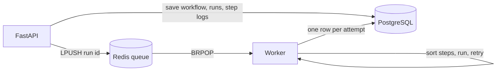

# FlowPilot

**A workflow automation engine, like a small n8n or Zapier, built from scratch in Python.**

You connect steps (a trigger, then an AI step, then an action), and FlowPilot works out the right order, runs them in the background, retries what fails, and logs every attempt.

Example workflow: *every morning, read my unread emails → AI picks the urgent ones → send me a summary.*


## Status

| Part | State |
|---|---|
| Workflow API (create, read, update, delete) | ✅ Done |
| Running order (topological sort, cycle detection) | ✅ Done |
| Passing data between steps (`{{n1.output.x}}` templates) | ✅ Done |
| Redis job queue + background worker | ✅ Done |
| Executor with retries, backoff and per-attempt logs | ✅ Done |
| LLM step (timeout, structured JSON output, repair retry) | 🚧 In progress |
| HTTP and email actions, scheduled triggers | ⏳ Next |
| Visual canvas (Next.js + React Flow) | ⏳ Planned |

**31 tests pass in GitHub Actions CI**, with lint and format checks on every push.

## How it works



1. **Start a run:** the API checks that the workflow has no loops, saves a run as `queued`, puts its id on a Redis queue and replies straight away (HTTP 202).
2. **The worker** takes the next run id off the queue and runs the steps in order.
3. **Each step:** fill in its templates from earlier steps' outputs, run it, and save the result. If it fails, wait (1s, then 2s) and try again, up to 3 attempts.
4. **The run ends** as `succeeded`, or as `failed` with the step that broke and why.

## Design decisions

**Why a queue and a separate worker?**
A run can take minutes (LLM calls, retries with waits). The API only queues the run id, so it replies in milliseconds. To handle more runs, start more workers: they all share one queue.

**Why put only the run id on the queue, not the whole workflow?**
The database is the single source of truth. The worker always loads the latest saved version, and the queue messages stay tiny.

**Running order: Kahn's algorithm, O(V + E)**
Count how many arrows point into each step. Steps with zero are ready, so run one, then remove its outgoing arrows; any step that drops to zero becomes ready. Every step and every arrow is handled once, which makes it O(V + E).
If the sort finishes with fewer steps than the workflow has, there's a loop (for example, B waits for D and D waits for B). The API rejects it with **HTTP 422** before anything is queued.

**Retries: what gets retried, and what doesn't**
- Failed attempts wait 1s, then 2s (exponential backoff), with no wait after the last attempt.
- Steps with side effects (such as sending an email) are marked **non-retryable** and run once, so a retry can never send the same email twice.
- Success handling is in a separate `else` block, so an error while *saving* a result is never mistaken for the step failing.
- The wait function is passed in as a parameter, so tests check the exact waits (`[1, 2]`) without actually sleeping.

**Known gap: a worker crash in the middle of a run**
`BRPOP` removes the run id from Redis as soon as a worker takes it. If that worker crashes halfway through, the run stays `running` forever, and no other worker will pick it up.
Planned fix: move the id to a "processing" list instead of deleting it (`LMOVE`), remove it only when the run finishes, and have a small reaper re-queue runs that have been `running` for too long.

## Run it

```bash
cd backend
python -m venv .venv && source .venv/bin/activate
pip install -r requirements-dev.txt
python -m pytest -q        # 31 passed (uses SQLite + a fake Redis, so no services needed)

# full stack with Docker
cd ..
docker compose up --build  # API docs at http://localhost:8000/docs
```

## Tech

Python 3.12 · FastAPI · async SQLAlchemy · PostgreSQL · Alembic · Redis · Docker Compose · pytest · ruff · GitHub Actions
