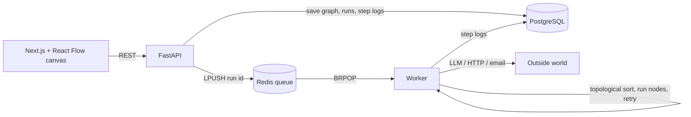

# FlowPilot

**A visual AI workflow builder.** Connect blocks (Trigger → AI step → Action) on a canvas, and FlowPilot runs them in the background with retries, then logs every step's input, output, time and cost.

Demo workflow: *every morning, read my unread emails → AI picks the urgent ones → send me a WhatsApp summary.*

> Status: **scaffold.** The API, database, Docker, CI and tests are done. The engine (the interesting part) is yours to build, week by week. Unfinished endpoints reply **HTTP 501 and name the file to open.**

## Architecture



**Why a queue and a worker?** A run can take minutes (LLM calls, retries with waits). The API answers in milliseconds by only queueing the run; the worker does the slow part. To handle more runs, start more workers.

## Run it

```bash
# tests: no Postgres or Redis needed (SQLite + fake Redis)
cd backend
python -m venv .venv && source .venv/bin/activate
pip install -r requirements-dev.txt
python -m pytest -q          # starts at: 7 passed, 24 xfailed

# full stack in Docker
cd ..
docker compose up --build    # API docs: http://localhost:8000/docs
# first time only, in another terminal:
docker compose exec api alembic revision --autogenerate -m "initial tables"
docker compose exec api alembic upgrade head
```

Commit the migration file Alembic creates in `backend/alembic/versions/`.

## How the tests guide you

Tests for unwritten code are marked `@todo(week, "...")`. Each one shows its state:

| You see | Meaning | Do |
|---|---|---|
| `x` (xfailed) | Your function still raises `NotImplementedError` | Write it |
| `F` (failed) | You wrote it, but it's wrong | Read the assertion, fix it |
| `XPASS(strict)` | It's correct | **Delete the `@todo(...)` line above that test** |

Finish line: **31 passed, 0 xfailed.**

## Done vs your TODOs

| Done (read and understand it) | Your TODOs |
|---|---|
| `models.py`: workflows, runs, step_runs | **Week 1:** `engine/graph.py`: `topological_sort`, `upstream_of` |
| `schemas.py`: graph shape validation | **Week 2:** `engine/templating.py`: `{{n1.output.x}}` |
| `api/workflows.py`: CRUD | **Week 2:** `engine/queue.py`: Redis LPUSH/BRPOP |
| `api/runs.py`: start run, run history | **Week 2:** `engine/executor.py`: order, retries, backoff, logs |
| `engine/nodes/base.py`: node registry | **Week 2:** `worker.py`: `process_one` |
| Docker Compose, Alembic, CI, error handling | **Week 3:** `nodes/llm.py`, `nodes/actions.py`, schedule trigger |
| | **Week 4:** frontend (React Flow canvas, run history) |

## Build plan

### Week 1: the running order
- [ ✔️] `topological_sort` (Kahn's algorithm). Read the docstring, then write it without looking anything up first
- [✔️ ] `upstream_of`
- [ ✔️] All `test_graph.py` tests pass, plus `test_cycle_is_rejected_before_queueing`
- [✔️ ] Explain in this README: why O(V + E)? What happens with a cycle?

### Week 2: the engine
- [✔️ ] `templating.render` and `lookup`
- [✔️ ] `queue.enqueue_run` / `dequeue_run`
- [ ✔️] `executor.execute_run` with retries (1s, 2s, 4s backoff)
- [ ✔️] `worker.process_one`
- [ ✔️] All 31 tests pass. Then run `docker compose up --scale worker=2` and start two runs at once
- [ ✔️] Explain: what happens if the worker crashes in the middle of a run? (There's a real gap here. Find it and write it down.)

### Week 3: AI and the outside world
- [ ] `llm.prompt` node: timeout, structured JSON output, one repair retry, tokens and cost logged
- [ ] `action.http` (retry 5xx, not 4xx), `action.email` (never retried: why?)
- [ ] Schedule trigger + a small scheduler process
- [ ] Tests with fake clients only. Never call real APIs in tests

### Week 4: frontend
- [ ] Next.js + React Flow canvas: add blocks, connect them, edit config in a side panel
- [ ] Save/load workflows, a Run button, live status (polling `GET /runs/{id}`)
- [ ] Run history page: each step's input, output, error, time and cost

### Week 5: ship it
- [ ] Deploy (API + worker + Postgres + Redis; frontend on Vercel)
- [ ] The demo workflow working end to end
- [ ] Screenshots, a 2-minute Loom, and the results below

## Results (fill in as you build; these become resume bullets)
- Tests: __ passing in CI
- Runs executed: __ · average run time: __ s
- Failed steps recovered by retry: __ %
- LLM cost per run: $__
